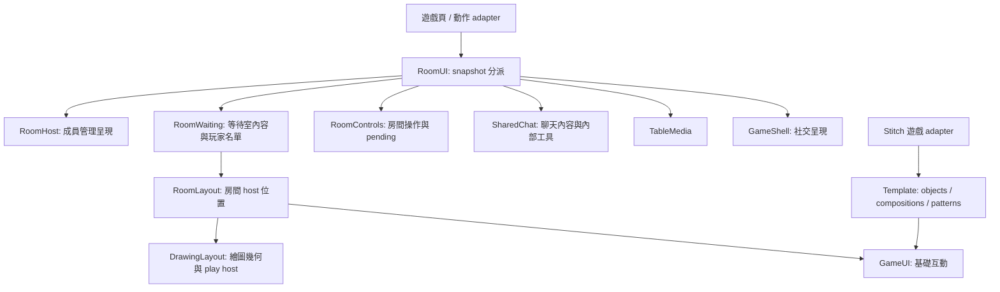

# 前端 UI 階層與共用 module

2026-10-15；基於 cf80116（2.8.0）及前輪未提交重構。以目前畫猜與郎中的完整 UI 為基準，保留各遊戲專屬玩法與布局。這是同一工作樹的增量重構，不代表正式站狀態。

## 責任方向

遊戲頁仍持有局內狀態與玩法命令。RoomHost.update(snapshot, render)／GameShell.update 保留原呼叫端相容入口，轉交 RoomUI；renderSnapshot 不再向另一個狀態入口發送。命令與聊天回應交給 RoomUI.acceptSnapshot，先讓遊戲 owner 接受，再保證共用呈現只分派一次。相同版本較新的 serverNow 仍能更新倒數；舊版本／舊 clock、不同 room instance 與 stop 後回應不覆蓋目前房間。

RoomWaiting 提供 hero／roster refs；RoomLayout 集中等待、遊玩、訪客側欄、聊天 dialog、下一局設定 dialog 的 placement 與回復位置。DrawingLayout 集中畫板量測、響應式 fitting、繪圖遊戲 play host；GameUI 相容方法向下指向該 module。基礎 ui-components 不再向上查 Template.patterns.measureBoard。

Template 保留可重用構造與等待畫面裝飾，移除房間 host 搬移及畫板量測。SharedChat 擁有自己的 header／tools，Stitch 透過明確 lifecycle 事件更新，不再觀察整個 body 並事後搬聊天工具。等待畫面的聊天／說明／離房直接呼叫明確命令，不用 selector 找按鈕再 click。

## 房間操作 seam

RoomControls.bindActions({type, read, run}) 沿用郎中試點，擴展到所有 11 款遊戲；room-controls 不再用 findAction、按鈕文字或 MutationObserver 探測開始／AI。read 提供準備階段、動作名稱、可用狀態與必要動作位置；run 執行遊戲擁有的房間操作。RoomControls 管理實體按鈕、pending、防重、名單 AI 槽與焦點。

- 撲克 showdown 用 setup 明確表示發下一手；舊快照缺 type 時以 poker 相容。
- 賽車保留自己 AI route 與四人上限，不能套用其他遊戲 botSupport 的含義。
- 畫猜結束頁使用同一實體開始按鈕；設定入口由 RoomLayout 管理。
- autoSaveSettings／bindSettings 保存最後錯誤與 revision；較舊請求成功不清掉較新輸入錯誤。開始前 flush 後檢查 error()，避免設定失敗仍開局。保存等待者會等待前次請求 settle 再繼續 flush，不讓舊失敗產生未處理 rejection，也會等待最新 queued 保存完成。

這個 seam 有真實 adapter 的差異（最低人數、準備／開始、下一手、保存條件），不是每個呼叫端都要知道共用 DOM 的 pass-through。depth 來自共用 pending／焦點／槽位管理；locality 讓修正集中，leverage 涵蓋所有遊戲。

## CSS 所有權

原 stitch-fidelity.css 與 quacks-stitch.css 成為相容載入清單。

| Owner | 責任 |
| --- | --- |
| shared/stitch-tokens.css | 主題與版面尺寸／間距 tokens |
| shared/stitch-skin.css | 色彩、文字、邊線、陰影等外觀 |
| shared/stitch-composition.css | 共用房間與 Draw 的組合幾何 |
| quacks-theme.css | 郎中專屬外觀 |
| quacks-layout.css | 郎中專屬布局與槽位 |

122 處等值尺寸／間距改用 tokens；5780 個宣告的 selector、media、layer、同 property 及 shorthand 家族先後關係均經審核。保留必要的原 cascade／important 語意，沒有宣稱 specificity 債務已全部消除。Draw 與共用等待室幾何仍共處 composition owner，避免此次機械拆開交錯 selector 造成優先序改變。詳細遷移與檢查見 [UI-STYLE-OWNERSHIP.md](UI-STYLE-OWNERSHIP.md)。

## 實際驗收

實作階段先以 3115 測試站的真正 Chrome 操作及量測驗收；當時尚未執行套件。後續套件驗證見下節。

- snapshot：6 個呈現 slots 每次各 1 次；同版本 clock 刷新、過期回應、callback 略過、stop、reload 及實際 social 回應通過。
- 郎中一回合：實際女巫直接命令、採購／取消精確退費及返焦、1440／390／320 採購無橫溢，走至 between；無 pageerror。
- 畫猜：房主／訪客 1440／390／320 等待室、聊天／說明／離房確認與焦點；設定 503 阻止開始且面板維持 416×758，成功重試可開局；結束頁三尺寸、下一局設定與實體再玩按鈕通過。
- 畫猜同步回歸：雙席持筆、延遲 ACK＋SSE、reset-before-ACK 無殘影、ACK 無 SSE、undo／clear quota、重連、換輪與倒數；過程採樣與最終畫布皆檢查。桌機／390／320 無橫溢。
- 郎中：女巫直接命令、採購／取消精確退費及焦點、一回合至 between；桌機／390／320 採購無橫溢。
- 其餘九款：1440／390 等待室、最低人數、UI 加 AI、開始連點只送一次、非房主限制與滿員；撲克發下一手／權限移交、TRPG 選角、Bluff 設定 503 阻擋及恢復。
- CSS：72 組 before／after，兩遊戲×房主／訪客×三寬度×亮暗的 waiting、active、active reduced motion。所有 computedStyle 一致；正常動畫只存在 timerFill／氣泡／蒸氣取樣差，reduced motion 矩形亦一致。無橫溢或 pageerror。
- 並行保存壓力：首個設定請求延遲 600ms 後 503，其間注入第二筆有效 change（原生欄位保存時 disabled）；第二次真 HTTP 保存 120 秒、pending=false、error 空，之後真 UI 加 AI／開始到 choosing。pageerror 與 unhandledrejection 皆空。事件注入僅用來驗證已排入編輯的並行情境。
- 變更 JS 語法與 git diff --check、style ownership 靜態檢查通過。6 份既有 browser fixture 隨載入拆分更新，未更改斷言、未執行套件。

可重複的真瀏覽器 QA 位於 tools/qa/ui-snapshot.cjs、ui-room-adapters.cjs、ui-room-adapters-extended.cjs、ui-flow.cjs、ui-autosave-wait.cjs；需私有 QA_CREDENTIALS_FILE，程式與本文件均不包含帳密。作畫／郎中回歸另使用前輪 tools/qa/architecture-234.cjs。

限制：不是所有遊戲的完整對局驗收；未新增郎中九回合、實機觸控與全站完整可及性結論。CSS 比較凍結同一遊戲狀態與 clock，用來隔離 CSS 差異；實際動畫／筆跡由另一次原生流程驗收。

證據索引（本機暫存）：ui-autosave-wait-qa/results.json、ui-snapshot-qa/results.json、ui-room-adapters-qa/results.json、ui-room-adapters-extended/results.json、ui-architecture-native-qa/results.json、ui-architecture-flow-qa/results.json、ui-css-refactor/browser-*/。各目錄含相應桌機／手機截圖；VM repo 外 ui-architecture-before/ 保存 CSS 原件、順序審核與瀏覽器摘要。

## 2026-10-15 PR 前套件驗證（2.8.1）

基底已對齊 GitHub main `05640c9`（與原候選基底 cf80116 的 tree 相同）。本次把累積架構修改整理於 `codex/deepen-ui-architecture-20261015`。

- Linux Node v22.22.1：完整 `npm test`（含 pretest release check）2229 項全數通過；0 fail／0 cancelled／0 skipped。
- 6 項新增保存競態回歸：兩種共用保存器都驗證等待最新 queued 保存、舊成功不抹掉新無效輸入、失敗保留至有效重試成功。
- 共用操作使用實際 RoomControls 驗證按鈕位置、房主權限、容量、階段、連點鎖定、失敗恢復焦點與跨房間晚回覆；遊戲 client fixture 只捕捉明確 adapter，玩法斷言保留。
- 畫布復原保留中途移動、像素及 fill 次數斷言。等待 renderer 完成後檢查持筆草稿，結束時取消未回覆的模擬請求；不把網路逾時當作繪圖完成。
- 67 個變更 JS 語法、CSS ownership、11 款入口的新資產唯一載入／順序、`release:check -- --base 05640c9 --type patch`、`git diff --cached --check` 通過。提交範圍未包含私有登入檔、QA 輸出或 node_modules。

上述套件結果取代實作階段「尚未執行」的狀態。瀏覽器／桌機／手機驗收仍引用本文件上一節，沒有因套件通過而擴大實玩結論；Windows CI 以 PR 的實際 check 狀態為準。

## 2026-10-15 PR #127 最新 main 整合複查（2.13.1）

固定基底 main `eb648ce3a2c4b17ef8405f527ad30dd0f360745b`，原 PR head `4973219a00f6ab32b6d48f5da5dd6751ea27a46f`。main 後續新增功能造成 13 個檔案衝突，本次逐段整合至同一 PR；不恢復 selector 探測或整包 CSS。

範圍審查：保留 main 的八人郎中、自動占卜、抽停圖片／語音、爆鍋時序、殘酷二選一、隨機先手與 Bluff 秘密角色簡化。共用 RoomUI／RoomLayout／操作 adapter／DrawCanvasSession 及 CSS 所有權仍保留。修正郎中 adapter 舊 4／5 人 AI 上限與同頻 adapter 固定 3 人開局門檻，避免新模式被舊接線阻擋。候選版本從已發布 2.13.0 遞增為 2.13.1。

程式與回歸審查：檢查命令、保存失敗阻擋、pending、防重與跨輪、入口及靜態資產註冊；11 款入口均包含三個共用架構 module。整合驗收曾發現郎中有版本 query 的 ui-components 入口未載入布局 module，已補齊，重驗設定可點擊、面板布局與焦點。main 個人設定新增的 scrollbar-gutter 依原所有權規則移至 skin。

本次隔離測試站（3132）真 Chrome 驗證：

- 九款 adapter：1440／390 等待室、最低人數、UI 加 AI、開局及連點只送一次、撲克下一手；無 pageerror。
- 同頻：單人殘酷二選一可開始作答。郎中：AI 可加至八人，滿員停用；1440／390 無頁面水平溢出。
- 郎中：準備／藥材書及返焦、設定 503 阻擋與成功重試、延遲加 AI／開局連點只送一次、finished 重載再開局；1440／390／320 的 pending／長錯誤前後面板及操作列尺寸一致。
- 郎中一回合：實際女巫直接命令、採購／取消精確退費及返焦、1440／390／320 採購無橫溢，走至 between；無 pageerror。
- 畫猜：房主／訪客 1440／390／320、聊天／說明／離房返焦、設定 503 阻擋與恢復、結束及下一局設定／再玩。
- 作畫：雙席持筆途中與延遲 ACK／SSE 無閃白；觀看端逐點呈現、最終畫布一致；undo／clear 額度、重連、reset-before-ACK 無殘影、無 SSE 的 ACK、倒數與換輪空畫布均通過。
- 67 個差異 JS 語法、style ownership、release:check 及 diff whitespace 檢查通過。

本次沒有執行測試套件。隔離資料與驗收帳號只用於測試站，未操作正式服務；未合併 main 或正式發布。未驗真實手機觸控／Safari、所有遊戲完整對局與郎中九回合。截圖及 JSON 證據保存在本機 PR127 review QA 目錄，不納入發布資產。

### PR #127 CI 後續修正

10237b7 的 Linux CI 失敗於 unified-room-controls 測試：舊測試仍依賴已移除的 findAction 函式邊界擷取程式碼，indexOf 回傳 -1 後造成 VM SyntaxError。改用既有完整 RoomControls DOM fixture 驗證設定來源替換仍保留其他原生操作，並獨立捕捉真實 majority command adapter，保留單人個人模式、隊伍人數、一般最低人數及 busy 限制斷言。沒有改動網站執行程式。Linux Node22 與 Windows Node22 的該檔均 8/8 通過；完整結果以修正提交的 CI 為準。
